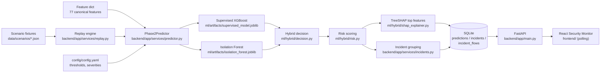
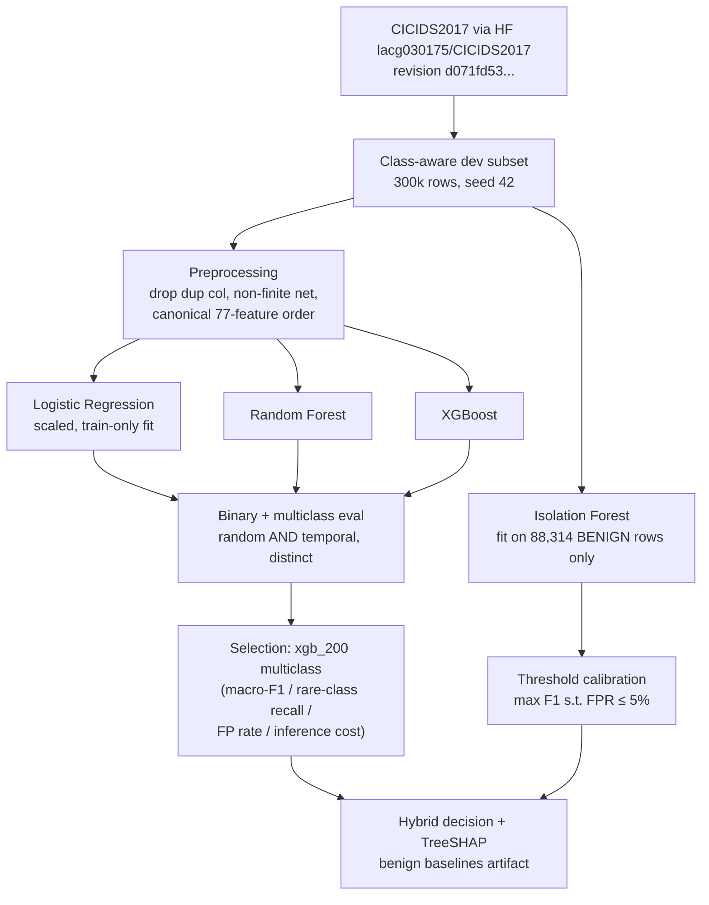
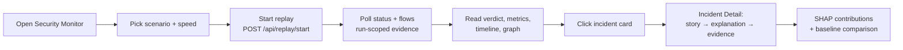

# AI-Powered Network Intrusion Detection & Security Evaluation System

An explainable, CPU-only network intrusion detection prototype: a supervised XGBoost classifier and a benign-only Isolation Forest feed a deterministic hybrid decision layer with transparent risk scoring, and a React monitoring UI replays recorded CICIDS2017 traffic scenarios so every verdict — known attack, unknown suspicious, or benign — can be inspected as grouped incidents with SHAP-based model explanations. Built as a student-scale academic project (approved Phase-4 first version implemented; final verification evidence is in docs/TESTING.md).


> **What this is not:** a production SOC tool, a live-packet-capture IDS, or a zero-day detector. It replays **recorded, labelled CICIDS2017 flows** through a frozen ML pipeline. "Unknown suspicious" means *a hybrid anomaly alert*, not real-world zero-day detection (see [Detection Pipeline](#detection--decision-pipeline) and [Limitations](#limitations)).

---

## Table of Contents

- [Overview](#overview)
- [Key Features](#key-features)
- [System Architecture](#system-architecture)
- [Detection / Decision Pipeline](#detection--decision-pipeline)
- [ML Pipeline](#ml-pipeline)
- [Model & Evaluation](#model--evaluation)
- [Explainability](#explainability)
- [Backend Architecture](#backend-architecture)
- [Frontend](#frontend)
- [Scenario / Replay Workflow](#scenario--replay-workflow)
- [Project Structure](#project-structure)
- [Installation](#installation)
- [Running the Project](#running-the-project)
- [Model Artifacts & Fresh Clones](#model-artifacts--fresh-clones)
- [Manual Testing Checklist](#manual-testing-checklist)
- [Testing](#testing)
- [Reproducibility](#reproducibility)
- [Scientific Integrity Safeguards](#scientific-integrity-safeguards)
- [Limitations](#limitations)
- [Roadmap — Future Phases (Not Implemented)](#roadmap--future-phases-not-implemented)
- [Documentation](#documentation)
- [Contributing](#contributing)
- [License](#license)

---

## Overview

**Problem.** Small networks (college labs, small organisations, personal servers) cannot afford SOC tooling, and when they evaluate monitoring products they can rarely see *why* a detector made a decision. Classical IDS demos either show raw tables of scores or a black-box accuracy number.

**Approach.** This system turns one CICIDS2017-trained ML pipeline into an inspectable investigation loop:

1. A **supervised classifier** (XGBoost, 15 CICIDS2017 classes) recognises attacks it was trained on.
2. A **benign-only Isolation Forest** flags flows whose feature behaviour departs from learned normality — the proxy for attacks the classifier has never seen.
3. A **deterministic hybrid decision layer** combines both signals into one of exactly three outcomes: `BENIGN`, `KNOWN_ATTACK`, or `UNKNOWN_SUSPICIOUS`.
4. A **rule-based risk score** (0–100, LOW/MEDIUM/HIGH/CRITICAL) and **rule-based incident grouping** turn per-flow verdicts into coherent security events.
5. A **replay engine** streams committed scenario fixtures through the live pipeline; the **Security Monitor** UI shows the story: verdict → severity → who was involved → incidents → evidence → model explanation.

**Why hybrid:** a supervised-only detector silently labels structurally-benign-looking novel attacks as benign. The anomaly branch exists to surface exactly those cases as *unknown suspicious* — and the repository's own temporal experiment measures (honestly) how limited that safety net is.

**Terminology in this implementation:**

| Term | Means here |
|---|---|
| *Known attack* | Supervised prediction is non-BENIGN with confidence ≥ 0.75 |
| *Unknown suspicious* | No confident known-attack decision, then Isolation Forest score below −0.0928; may be a benign false alert |
| *Replay* | Deterministic streaming of recorded flows at selectable speed (1×/5×/20×) — **not** live capture, **not** attack generation |
| *Incident* | Rule-grouped set of related suspicious flows (family + source + destination + time window; port excluded for scanning families) |

---

## Key Features

Current implementation includes the approved reliability, evaluation and Playground work of 2026-10-31; historical ML experiments retain their original dates and qualifications.

**ML / detection**
- XGBoost multiclass supervised model (15 classes, 77 canonical features) — `ml/artifacts/supervised_model_metadata.json`
- Benign-only Isolation Forest anomaly detector with FPR-constrained threshold calibration (max F1 subject to FPR ≤ 5%) — DEC-008
- Deterministic three-outcome hybrid decision layer with config-driven thresholds — `ml/hybrid/decision.py`
- Transparent rule-based risk scoring: family severity base × confidence factor + anomaly bonus — `ml/hybrid/risk.py`

**Security evaluation**
- Random vs temporal evaluation kept as distinct experiments (temporal = generalisation diagnostic, never the headline)
- Unknown/unseen anomaly simulation experiment with pinned wording "*NOT zero-day detection*" — `ml/evaluation/results/unknown_experiment_temporal.json`
- Isolation Forest sensitivity audit showing the low unseen recall is structural, not a tuning artifact — `ml/evaluation/results/if_sensitivity.json`

**Explainability**
- XGBoost-native TreeSHAP (`pred_contribs=True`) local explanations: top-5 features for the predicted class with `pushes_towards` / `pushes_against` direction — `ml/hybrid/shap_explainer.py`
- TreeSHAP additivity verified by a committed pytest across all 15 classes
- Behaviour-vs-benign-baseline comparison per flow (median/p25/p75 of 10 key features) — `ml/artifacts/benign_baselines.json`

**Backend / API**
- FastAPI + SQLAlchemy + SQLite; JSON endpoints (replay control, live evidence feed, incident list/detail, baselines, single-flow predict, health)
- In-process replay engine with IDLE/RUNNING/PAUSED/COMPLETED/STOPPED/FAILED lifecycle and per-run `run_id` evidence scoping
- Deterministic incident grouping with persisted aggregates — `backend/app/services/incidents.py`

**Monitoring UI (React + TypeScript + Vite + Tailwind)**
- Security Monitor with runtime-generated plain-language security verdict
- Replay controls (scenario, speed, start/pause/resume/stop) with human-readable scenario labels
- Replay activity timeline + risk distribution (Recharts) with semantic severity colours
- Communication graph (Cytoscape.js) of *observed communications* — hosts, service ports, risk-coloured edges (not physical topology)
- Incident list as event cards + story-first Incident Detail page
- Hybrid semantics shown as three separations: supervised prediction ≠ anomaly signal ≠ final IDS decision
- No authentication, no WebSockets — polling every 1.5 s (locked architecture decisions)

---

## System Architecture



The whole stack runs on CPU; the frontend is served by Vite's dev server, which proxies `/api` to Uvicorn on `127.0.0.1:8000`. No CORS middleware or authentication exists — this is a single-machine demo topology, by design.

---

## Detection / Decision Pipeline

The hybrid logic is 5 lines of deterministic code (`ml/hybrid/decision.py`), evaluated per flow in this exact order:

```python
if confidence >= 0.75 and predicted_label != "BENIGN":
    return KNOWN_ATTACK          # confident, non-benign supervised prediction
if anomaly_score < -0.0928:      # Isolation Forest decision_function
    return UNKNOWN_SUSPICIOUS    # anomaly rescue — NOT gated on confidence
return BENIGN
```

Key semantics, verified against code and regression tests:

- **The anomaly rescue is not gated on classifier confidence.** A high-confidence BENIGN prediction whose flow is abnormal enough per the Isolation Forest is still surfaced as `UNKNOWN_SUSPICIOUS` (regression: `test_high_confidence_benign_rescued_by_anomaly`, DEC-010/BUG-007). This is what makes the UI show "classifier said benign, anomaly detector said abnormal" without contradiction.
- **Thresholds are config-driven**, read at predictor load from `config/config.yaml` → `inference.known_confidence_threshold: 0.75` (validated: acc 0.9991 at conf ≥ 0.75 on random/test; historical claims named the 3-way split inconsistently) and `inference.anomaly_threshold: -0.0928` (calibrated to max F1 subject to FPR ≤ 5%; the raw sweep value is −0.092803, stored rounded).
- **`anomaly_score` is the Isolation Forest `decision_function`** — lower means more abnormal; it is not a probability.

Risk score (`ml/hybrid/risk.py`, all constants from `config/config.yaml` → `risk:`):

```text
severity = 60.0 if UNKNOWN_SUSPICIOUS
         = severity_table[BENIGN] (=5)  if BENIGN
         = severity_table[family]       if KNOWN_ATTACK
           (Denial of Service 90, Brute Force 70, Reconnaissance 50,
            Web Attack 80, Heartbleed 95, Infiltration 85, Botnet 60)

BENIGN flows:                    score = severity × 0.5            (→ 2.5, always LOW)
suspicious flows:                score = severity × (0.5 + 0.5·confidence) + 15 × anomaly_signal
  anomaly_signal = 0 when anomaly_score ≥ 0, else
                   max(0, min(1, (threshold − score) / max(0.1, −threshold)))

level: ≥85 CRITICAL · ≥65 HIGH · ≥40 MEDIUM · else LOW
```

Worked examples from persisted evaluation evidence (`ml/evaluation/results/e2e_evidence_phase2.json`): confident DDoS Hulk → 92.67 CRITICAL; PortScan → 50.0 MEDIUM; rescued benign → 72.92 HIGH; benign → 2.5 LOW.

**Ground-truth labels are never inputs.** Scenario files carry `ground_truth_label` for scoring *after* the run; the predictor never sees it (BUG-005 regression tests enforce runtime purity).

---

## ML Pipeline



Dataset identity is pinned end-to-end: HF repo `lacg030175/CICIDS2017`, revision `d071fd53782d9ca7cdc15173b8ceb858fea04628`, 15 canonical classes (raw U+FFFD characters normalised to ASCII hyphens — DEC-003), 80 raw columns reduced to **77 canonical features** by dropping the bit-for-bit duplicate `Fwd Header Length.1` (DEC-005, BUG-001). Random 80/20 and Mon–Thu→Friday temporal splits are separate experiments throughout; scaler fitting only ever uses training data (`docs/DATA_ML_CONTRACT.md`).

---

## Model & Evaluation

All numbers below are quoted from the committed artifacts in `ml/evaluation/results/` (shown to 4 decimal places).

**Baselines, random experiment (test n = 565,576)** — `baseline_metrics_random.json`:

| Model | Binary acc | Binary F1 | Binary ROC-AUC | Multiclass acc | Macro-F1 | Weighted-F1 |
|---|---|---|---|---|---|---|
| Logistic Regression | 0.8673 | 0.7468 | 0.9759 | 0.9470 | 0.5344 | 0.9514 |
| Random Forest | 0.9985 | 0.9963 | 0.9997 | 0.9983 | 0.8156 | 0.9983 |
| XGBoost (100 trees) | 0.9979 | 0.9947 | 0.9999 | 0.9987 | 0.8877 | 0.9987 |

**Promoted final model — XGBoost `xgb_200` multiclass (random experiment, test n = 565,576)** — `final_supervised_random.json`:

| Metric | Value |
|---|---|
| Accuracy | 0.9987 |
| Macro-F1 | 0.8898 |
| Weighted-F1 | 0.9988 |
| Derived binary FP rate of deployed multiclass classifier (before hybrid) | 0.001187 (539 / 454,265 benign records) |
| Train time | 78.5 s |
| Inference time | 3.9 s / 565,576 flows |

Selection was made on the documented PRD criteria, **not accuracy alone** (DEC-007): `xgb_200` beat the RF candidate on macro-F1 (0.8898 vs 0.8156), separately trained binary-model FP rate (0.0014 vs 0.0017; not the deployed hybrid), rare-class recall (SQL-Injection 0.667 vs 0.0), and inference cost (3.9–4.2 s vs 7.0 s per full test set).

**Evaluation qualification:** six supervised variants were selected using `random/test`, and the final artifact was reported on that same split. These are development benchmark results, not an untouched final assessment. The 0.1433% FPR (651 benign false alerts) belongs to the separate binary classifier; the deployed multiclass classifier has 0.11865% derived binary FPR before confidence gating and IF rescue. The executed shared-cohort comparison is documented in `docs/EVALUATION_PROTOCOL.md` and `locked_hybrid_random.json`.

**Temporal experiment (Mon–Thu train → Friday test, n = 702,718)** — `baseline_metrics_temporal.json` — is kept deliberately separate and used **only as a generalisation diagnostic**: all models degrade to ≈0.59 multiclass accuracy / ≈0.05 macro-F1 on unseen-day traffic (macro-F1 is deflated because 11 train-only classes score with zero support). This gap is the scientific reason the anomaly branch exists.

**Isolation Forest** (`train_isolation_forest.py`, DEC-008): fit on 88,314 benign rows only, no scaling, `random_state=42`. Threshold calibrated to **max F1 subject to FPR ≤ 5%** on `random_3way/validation` → deployed value **−0.0928**. Reported on the disjoint `random_3way/test` (n = 282,788) — `anomaly_evaluation_random.json`: precision 0.7662, recall 0.2951, F1 0.4261, FPR 0.0221.

**Unknown/unseen experiment** — `unknown_experiment_temporal.json`, `unknown_rescue_summary.json`: on Friday-only traffic, the detector flags a **7.5% aggregate recall** of unseen malicious flows (Bot 1.4%, DDoS 16.9%, PortScan 0.01%) at FPR 3.5%; the hybrid incrementally rescues only **24 of 103,601** flows the classifier had already missed. A four-config sensitivity audit (`if_sensitivity.json`) found aggregate temporal recall of 7.4955–7.6569%; two configurations are equivalent because auto resolves to 256 samples. These limited variations did not materially improve recall. The project's own artifact wording is preserved: *unseen / unknown anomaly simulation (**NOT zero-day detection**)*.

---

## Explainability

Implemented in `ml/hybrid/shap_explainer.py`:

- **What it explains:** the supervised XGBoost classifier only — never the hybrid decision and never the Isolation Forest. The UI section is titled "What Influenced the Model Prediction?" with an explicit disclaimer that these are model contributions, not causal explanations.
- **How:** XGBoost **native TreeSHAP** via `booster.predict(..., pred_contribs=True)` — not the `shap` Python package's `TreeExplainer`, which cannot parse XGBoost 3.2's multiclass `base_score` vector (DEC-009 / BUG-006).
- **Which class:** contributions are taken for the **argmax predicted class only**; the top 5 by |value| are persisted with the prediction and labelled `pushes_towards` / `pushes_against`.
- **Feature mapping:** contributions are indexed against the canonical 77-feature order in `supervised_model_metadata.json`, hard-validated at predictor load.
- **Verified:** `test_shap_additivity_across_all_classes` asserts bias + Σ contributions == model margin for every one of the 15 classes (atol 1e-4).

For `UNKNOWN_SUSPICIOUS`, the classifier either predicted BENIGN or lacked sufficient confidence in a malicious prediction; anomaly detection then escalated the flow. SHAP explains that actual supervised prediction, not the anomaly verdict.

---

## Backend Architecture

FastAPI app `backend/app/main.py`; SQLAlchemy models in `backend/app/db/models.py`; SQLite database auto-created at `data/network_ids.db` (override with env var `NETWORK_IDS_DB`). Tables: `predictions` (one Phase-2 verdict per flow, incl. persisted SHAP and full feature dict), `incidents`, `incident_flows`, plus `playground_profiles`, `playground_runs` and `playground_results` for separate saved scenario assessments. Playground never writes Monitor predictions or incidents. The additive migration records inference-time anomaly thresholds; old rows retain null rather than guessed thresholds.

### API endpoints (complete, verified against registered routes)

| Method | Endpoint | Purpose |
|---|---|---|
| GET | `/api/health` | Liveness + lazy model-load probe (`status`, `model_loaded`, `feature_count`) |
| POST | `/api/predict` | Score + persist one flow given its exact 77-feature dict (engineering interface; no UI screen uses it in Phase 3) |
| GET | `/api/replay/scenarios` | List valid scenario fixtures (`name`, `description`, `flows`) |
| POST | `/api/replay/start` | Start a replay run `{scenario, speed}` → new `run_id`, spawns worker thread (409 if busy/invalid state) |
| POST | `/api/replay/pause` | RUNNING → PAUSED (409 otherwise) |
| POST | `/api/replay/resume` | PAUSED → RUNNING (409 otherwise) |
| POST | `/api/replay/stop` | RUNNING/PAUSED → STOPPED; unclosed incidents committed |
| GET | `/api/replay/status` | In-memory replay state: progress, counters, max risk, `run_id` (Monitor polls this) |
| GET | `/api/replay/flows` | Newest-first persisted replay evidence (`limit` 1–500; optional `run_id` scoping) |
| GET | `/api/incidents` | Grouped incidents, newest-first (filters: `source`, `destination`, `family`, `classification`, `run_id`) |
| GET | `/api/incidents/{id}` | Incident detail: evidence flows + persisted SHAP top features + baseline feature subset |
| GET | `/api/baselines/benign` | Static benign-baseline artifact (median/mean/p25/p75/std per feature, 88,314 benign flows) |
| POST | `/api/playground/profile` | Validate/save environment profile and preview deterministic prepared suite |
| POST | `/api/playground/run` | Evaluate saved profile ID synchronously (at most 64 flows), persist assessment |
| GET | `/api/playground/results/{run_id}` | Retrieve saved evidence/context without recomputation |

Additionally FastAPI serves `/docs` (Swagger UI) and `/openapi.json`. The replay engine is a single in-process worker thread with polling status — **no WebSockets** (ARCHITECTURE_LOCK #15).

---

## Frontend

React 18 + TypeScript + Vite + Tailwind CSS; charts via Recharts; graph via Cytoscape.js; typed API client (`frontend/src/api/client.ts`) + 1.5 s polling hook. Existing Monitor/Incidents views plus the approved Playground:

**Security Monitor** (`frontend/src/pages/SecurityMonitor.tsx`)
- Replay controls: scenario picker with human-readable labels, Start/Pause/Resume/Stop, speed 1×/5×/20×, clear state indicator
- Runtime-generated **security verdict banner** ("Reconnaissance detected", "Denial of Service detected", "Unrecognized suspicious behavior", "No suspicious activity detected") derived from real incident + status data — never hard-coded per scenario
- Summary cards: flows analysed, suspicious flows (known vs anomalous split), incidents, max risk
- Replay activity timeline (bar per flow: height = risk, colour = benign/known-attack/unknown) + risk distribution by severity
- Communication graph: host nodes, dashed service-port nodes, risk-coloured directed edges; click-to-inspect selection panel; deterministic layouts for small scenarios
- Incident cards (family, risk badge, source → destination:port, flow count, time window)
- Live traffic table: time, source, destination, port, prediction, IDS decision, confidence %, Flagged/Normal anomaly, risk

**Incident Detail** (`frontend/src/pages/IncidentDetail.tsx`) — story first, evidence below:
- Hero block: attack family title, risk badge, source → destination:port, flow count + time window
- Incident-scoped communication graph
- "What Influenced the Model Prediction?" — TreeSHAP top-feature bars + disclaimer
- "Behaviour vs Normal Baseline" — per feature: current, normal median, ×-of-normal ratio, within/outside the p25–p75 band
- Hybrid decision breakdown (supervised vs anomaly vs final decision, separate rows)
- Evidence table with per-flow predictions

Benign (Normal scenario) runs render a calm healthy state. Security Playground is available in navigation. The Model Evaluation Lab remains deferred; `/api/predict` remains an engineering interface.



---

## Personalized Security Playground

Choose environment (Home/Lab/Small Organisation/Web Server), scale, exposure and
services. Preview deterministic rules, then run the selected prepared suite through
the same frozen predictor. Database/file-sharing coverage is explicitly unsupported.
Normal and benign anomaly controls are always included. No targets or network scans
are accepted. Runs are synchronous and bounded to 64 flows (current maximum 52).

Readiness = 100 × (0.5 × mean attack-scenario recall + 0.5 × pooled benign specificity).
Weights are configurable under `playground:` without changing inference. Missing
selected scenarios suppress the score; no attack or benign evidence makes it not
applicable. This is a scenario-specific educational summary, not a certified real
network rating. The report shows counts, result matrix, risk distribution, coverage,
weakest/strongest tested areas and actual flow explanations. Unknown-attack detection
is not established by the benign anomaly challenge.

Saved runs retain features, truth, outputs, SHAP for suspicious decisions, provenance,
profile/suite, model hashes/metadata and threshold/risk/scoring snapshots. Retrieval
uses the stored result. Failed/interrupted runs have no success score; restart marks
interrupted requests failed. SQLite unavailability can prevent durable failure writes.
Monitor evidence remains separate. See `docs/EVALUATION_PROTOCOL.md` for the stronger
shared-cohort comparison: hybrid rescue adds 2 detections and 5011 benign false alerts
on 282,788 reused random-test records, rather than improving every metric.

---

## Scenario / Replay Workflow

Seven committed fixtures (52 flows) live in `data/scenarios/` (schema `scenario/v1`). Original four vectors and sidecars are preserved. All use real 77-feature CICIDS2017 rows plus synthetic communication metadata, used only for presentation. `prepare_scenarios.py` records pinned-source row locators and hashes. Original PortScan 5/8 and DoS/DDoS 1/8 vectors exactly match deployed-training features; legacy row identity is uncertain. Three new sets exclude exact training-feature matches and were selected without predictions. These tiny fixtures demonstrate behavior, not unbiased detection rates. The original four outcomes below remain the live replay regression gate.

| Scenario | Flows | Pattern | Expected result |
|---|---|---|---|
| `normal` | 8 | real BENIGN flows, benign IP pair | 0 suspicious, 0 incidents |
| `portscan` | 8 | `10.0.0.50` → `10.0.0.9`, 8 distinct ports | 8 KNOWN_ATTACK → **one** Reconnaissance incident (MEDIUM, 50.0) — port excluded from grouping key for scanning families |
| `dos_or_ddos` | 8 | DoS Hulk + DDoS, `10.0.1.7` → `10.0.0.20:80` | 8 KNOWN_ATTACK → one Denial of Service incident (CRITICAL, ≈92.7) |
| `unknown` | 4 | BENIGN anomaly challenge | 4 UNKNOWN_SUSPICIOUS false alerts → one HIGH-risk incident; no attack-detection credit |
| `ssh_bruteforce` | 8 | held-out SSH-Patator | 8 detected |
| `ftp_bruteforce` | 8 | held-out FTP-Patator | 8 detected |
| `web_attack` | 8 | brute force 3, SQL injection 2, XSS 3 | 4 detected, 4 missed (retained) |

Replay pacing is deterministic: `sleep = logical_interval / speed` with logical interval 1.0 s, so speeds 1×/5×/20× change presentation timing only, never ordering or results.

---

## Project Structure

```text
.
├── backend/            FastAPI app, replay/incident services, SQLite models, tests
│   └── app/{api,services,schemas,db}/
├── frontend/           React + TypeScript + Vite monitoring UI
│   └── src/{api,components,pages,lib}/
├── ml/                 Data & ML pipeline
│   ├── preprocessing/  dataset loader, labels, preprocess, dev subset
│   ├── training/       baselines, model selection, final model, Isolation Forest
│   ├── hybrid/         decision, risk, shap_explainer, benign baselines
│   ├── evaluation/     metrics, scenario builder, E2E evidence, results/*.json
│   ├── artifacts/      feature/label/family schema + trained models (see below)
│   └── tests/          pytest suites
├── data/
│   ├── scenarios/      7 committed fixtures with provenance
│   └── processed/      dev-subset parquet (gitignored; .meta.json committed)
├── config/config.yaml  thresholds, severities, replay/incident settings
└── docs/               PRD-adjacent governance: phases, decisions, bugs, testing,
                        architecture lock, data contract, handoff, sprint log
```

---

## Installation

Requirements validated on this project: **Python 3.10.11** (no machine-enforced pin exists — `pyproject.toml`/`.python-version` are absent; 3.10.11 is the documented, validated interpreter), **Node.js ≥ 18** (nothing is declared in `package.json`; the frontend was validated on Vite 5 with Node 24). Windows PowerShell commands:

```powershell
# 1. Python environment
py -3.10 -m venv .venv
.\.venv\Scripts\Activate.ps1
pip install -r requirements.txt
pip install PyYAML          # used by the backend; currently missing from requirements.txt

# 2. Frontend
cd frontend
npm install
cd ..
```

Note on `requirements-lock.txt`: it is a raw `pip freeze` snapshot of a shared environment (UTF-16 encoded, ~130 packages, most unrelated to this project) rather than a curated lockfile. It is committed as an environment record; the key validated pins are fastapi 0.104.1, uvicorn 0.24.0, xgboost 3.2.0, scikit-learn 1.7.1, shap 0.49.1 (unused at runtime — see Explainability), pandas 2.3.2, numpy 2.2.6, SQLAlchemy 2.0.23, pyarrow 25.0.0, datasets 5.0.1.

## Running the Project

Two terminals, both from the **repository root** (the app resolves config/artifact paths relative to the tree):

```powershell
# Terminal 1 — backend (API on http://127.0.0.1:8000, Swagger at /docs)
python -m uvicorn backend.app.main:app --host 127.0.0.1 --port 8000

# Terminal 2 — frontend (Vite dev server proxies /api to :8000)
cd frontend
npm run dev          # http://localhost:5173
```

Models are loaded lazily on first use; `/api/health` pre-warms the predictor. For an isolated database: set `NETWORK_IDS_DB=<path>` before starting the backend.

## Model Artifacts & Fresh Clones

Required at inference time (`backend/app/services/predictor.py`):

| Artifact | In git? | Notes |
|---|---|---|
| `ml/artifacts/supervised_model.joblib` | **No (gitignored)** | XGBoost `xgb_200` — must be regenerated (below) |
| `ml/artifacts/isolation_forest.joblib` | Yes (explicit allow-list) | Benign-only IF |
| `ml/artifacts/supervised_model_metadata.json` | Yes | Feature order, params, provenance |
| `config/config.yaml`, `ml/artifacts/*.json` schemas, `data/scenarios/*.json` | Yes | Committed |
| `ml/artifacts/baselines/**`, dev parquets, `data/network_ids.db`, raw datasets | No | Large / regenerable (`.gitignore`) |

**Therefore a fresh clone will report `model_loaded: false` and `/api/predict` + replay start will fail until the supervised model is regenerated** (needs Hugging Face access to the pinned CICIDS2017 revision; the training set is a 300k class-aware subset, seed 42):

```powershell
python -m ml.training.train_final_supervised     # ~80 s CPU once the dev subset exists
```

The dev-subset build steps are documented in `docs/DATA_ML_CONTRACT.md` §§1–2 and `docs/PHASES/PHASE_1.md`. `ml/artifacts/inference/` is a Phase-1 provisional export kept for provenance; current runtime code does not load it.

## Manual Testing Checklist

1. Start backend + frontend (above); open http://localhost:5173.
2. Confirm header "System ready" and tabs Security Monitor, Incidents, Security Playground.
3. **Normal:** run *Normal Traffic* at 20× → verdict "No suspicious activity detected" (green), tiny green timeline bars, "No incidents detected".
4. **PortScan:** run *Port Scan* → "Reconnaissance detected" + MEDIUM; one incident card `10.0.0.50 → 10.0.0.9`; graph shows one host fanning into multiple `:port` nodes with readable labels.
5. **DoS:** run *Denial of Service* → "Denial of Service detected" + CRITICAL; tall red timeline bars over the green background traffic.
6. **Unknown:** run *Unknown / Anomalous* → "Unrecognized suspicious behavior" + HIGH, with the classifier-vs-anomaly explanation shown without contradiction.
7. Open an incident → hero states the event before any table; check "What Influenced the Model Prediction?" bars and disclaimer.
8. In *Behaviour vs Normal Baseline*, confirm current/median values with "× of normal" and within/outside-band labels.
9. For a DoS incident, the graph should show repeated traffic into one service port; for Unknown, the hybrid breakdown block should be present.
10. Check the browser console — the validated pass produced zero app errors.
11. Pause mid-replay, resume, stop — controls enable/disable with the replay state.
12. Playground: Home/internal/no services → preview normal + unknown; run → 0 detected, 4 false alerts, score not applicable (no attack evidence).
13. Playground: Web Server/public/Web → normal + unknown + web_attack + dos_or_ddos; run → 12 detected, 4 missed, 4 false alerts, score 70.83. Database is explicitly uncovered if selected.
14. Change profile → previous preview/result clears. Reload saved run ID → historical results restored. Check a missed web flow and a benign anomaly false alert in the evidence selector.

## Testing

Current verification evidence and exact counts are recorded in `docs/TESTING.md` (2026-10-31). Historical 92-test results below were superseded by the approved implementation regression run:

```powershell
# Full ML + backend suite (requires local artifacts and pinned dataset access)
python -m pytest ml/tests backend/tests -q

# Live replay E2E gate (boots its own uvicorn; writes ml/evaluation/results/e2e_replay_phase3.json)
python -m backend.tests.e2e_replay_phase3

# Frontend logic tests, type-check and production build
cd frontend
npm test
npm run build
```

Browser gates include the original replay/detail checks and current Home/Web/Lab Playground workflows, readiness loss/recovery, saved-result retrieval, actual misses/false alerts and Monitor isolation. The existing production bundle >500 kB warning (Cytoscape + Recharts) remains.

## Reproducibility

- **One seed, 42**, everywhere: dev subsets, all model fits (`random_state=42` in both artifacts' metadata), sensitivity audits.
- **Dataset revision pinned** to `d071fd53782d9ca7cdc15173b8ceb858fea04628`; loader, schema, and metadata all record provenance.
- **Random vs temporal splits are never mixed** within an experiment; preprocessing fits (scaler) use training data only.
- **Scenario fixtures are committed**, so replay + E2E + UI tests need no dataset download and no network.
- **Every reported metric** exists as a JSON artifact in `ml/evaluation/results/` written by the training/evaluation modules.
- Intentionally excluded from git: raw/parquet datasets, dev parquets, `ml/artifacts/baselines/**` (~140 MB), SQLite DBs, model binaries other than the explicit allow-list, venvs, `node_modules`.

## Scientific Integrity Safeguards

- Ground truth is separated from runtime: scenario `ground_truth_label` is evaluation metadata only; `predict()` receives features only (enforced by three BUG-005 regression tests).
- The IF threshold was calibrated on validation data under an FPR constraint. The 0.75 confidence gate was checked on reused test data; it is not a separately calibrated probability guarantee.
- Anomalous flags from the benign-only IF are reported with their measured false-positive and missed-detection behaviour — including the deliberately unflattering temporal numbers.
- Incident grouping is deterministic rule-based grouping over a 30 s window (config-driven), so incident counts are reproducible, not clustering artifacts.
- UI explanations never overstate: SHAP describes the supervised model only; the anomaly detector's role is described as anomaly detection, and replay timestamps are labelled synthetic.
- Ethical boundary (ARCHITECTURE_LOCK #20): no attack generation, no scanning of external/public addresses, no blocking or modification of real traffic, no live capture in the baseline.

## Limitations

Supported by the repository's own evidence:

- **Replay-only evaluation.** Traffic comes from recorded CICIDS2017 fixtures; there is no live packet capture path in this codebase.
- **No mitigation of any kind** — detection and explanation only; nothing blocks, drops, or alerts externally.
- **Weak generalisation, measured.** Both the supervised model (≈0.59 multiclass accuracy on temporal test) and the Isolation Forest (7.5% unseen recall, 24/103,601 incremental rescues) degrade on unseen-day traffic; "unknown suspicious" is an anomaly simulation, not zero-day detection.
- **Benign-only anomaly profile.** Some genuinely malicious-looking benign flows get flagged and structurally-benign attacks get missed (documented Phase-2 limitation; scenario fixtures select strictly-benign rows for the Normal case).
- **Single dataset, single label era.** CICIDS2017 only, per the locked scope; modern encrypted/evaded traffic is out of scope.
- **Demo-scale runtime.** Single in-process replay worker, polling UI, per-machine SQLite; no authentication or multi-user concerns; frontend bundle >500 kB.
- **Fresh clones need artifact regeneration** before prediction works (see [Model Artifacts & Fresh Clones](#model-artifacts--fresh-clones)).

## Roadmap — Future Phases (Not Implemented)

The approved first Playground version is implemented. Phase 5 remains deferred:
full Model Evaluation Lab, expanded incident investigation, presentation polish and
optional PDF export. Live ingestion, mitigation/firewalls, drift monitoring,
enterprise deployment, external alerting/SIEM, advanced threat intelligence,
multi-dataset generalization and stronger unknown/zero-day research remain future
work. They are not prerequisites for this phase.

## Documentation

| Document | Contents |
|---|---|
| [`Network_IDS_Security_Evaluation_PRD.md`](Network_IDS_Security_Evaluation_PRD.md) | Product requirements — single source of truth |
| [`docs/ARCHITECTURE_LOCK.md`](docs/ARCHITECTURE_LOCK.md) | 20 locked decisions + explicit non-goals |
| [`docs/DATA_ML_CONTRACT.md`](docs/DATA_ML_CONTRACT.md) | Canonical data/ML contract (splits, seeds, schemas) |
| [`docs/DECISIONS.md`](docs/DECISIONS.md) | DEC-001…DEC-016 decision records |
| [`docs/IMPLEMENTATION_STATUS.md`](docs/IMPLEMENTATION_STATUS.md) | Component-by-component status |
| [`docs/PHASES/`](docs/PHASES/) | Phase 1–5 plans, gates, and evidence |
| [`docs/TESTING.md`](docs/TESTING.md) | Validation commands and recorded results |
| [`docs/BUG_LOG.md`](docs/BUG_LOG.md) | BUG-001…BUG-013, each with root cause + regression |
| [`docs/HANDOFF.md`](docs/HANDOFF.md) · [`docs/SPRINT_LOG.md`](docs/SPRINT_LOG.md) | Continuity notes and permanent sprint history |

## Contributing

This is an academically scoped project with a frozen architecture. For changes: read `AGENTS.md` and `docs/ARCHITECTURE_LOCK.md` first, keep thresholds in `config/config.yaml`, run `python -m pytest ml/tests backend/tests -q` plus `npm run build` before opening a PR, and update the governance docs (`DECISIONS.md`, status/handoff/sprint log) alongside any meaningful change. Do not add dependencies or later-phase features without an accepted decision record.

## License

No license file is present in this repository, so no usage rights are currently granted. The project is an academic submission; add a `LICENSE` at the repository root if distribution rights are desired.

---

*Status: Phases 1–3 complete and frozen (2026-08-13, after the Phase-3 frontend UX validation pass). Phases 4–5 are planned but not started.*

## Scenario-library update (2026-10-31)

Seven prepared scenarios now include SSH brute force, FTP brute force and web
attacks (8 records each). Original replay vectors and side-cars are unchanged.
Run `python -m ml.evaluation.prepare_scenarios` after original fixture regeneration
to restore/check provenance. Preparation needs pinned evaluation data and the
existing dev training subset; replay does not.

`data/processed/scenario_provenance.json` discloses exact training-feature matches
in 5 original PortScan and 1 DoS/DDoS records. Legacy row locators identify first
equivalent rows, not recovered original IDs. New scenarios exclude exact training
matches and are selected without predictions. Four of eight web records are missed
by the frozen hybrid; those failures are deliberately retained.
