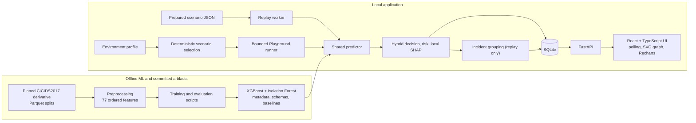

# AI-Powered Network Intrusion Detection & Security Evaluation System

This student-scale project evaluates recorded network-flow records for suspicious activity. It combines a supervised XGBoost classifier with an Isolation Forest anomaly signal, then presents replay evidence, grouped incidents and model-feature explanations in a local web application. The goal is to make detection behavior inspectable and reproducible for an academic demonstration.

It is a flow-record evaluation prototype, not an operational network sensor. It does not capture live packets, attack a network, block traffic, certify an environment, or establish reliable zero-day detection.

## What the application does

- Classifies CICIDS2017 flow features into one of 15 supervised classes using a saved XGBoost model.
- Scores deviation from benign training behavior with a saved Isolation Forest.
- Applies a deterministic, threshold-based hybrid decision: `KNOWN_ATTACK`, `UNKNOWN_SUSPICIOUS`, or `BENIGN`.
- Assigns a transparent project risk score and severity; risk is prioritization, not a standard security rating.
- Computes local native TreeSHAP contributions for the supervised prediction and compares selected flow features with benign baselines.
- Replays seven prepared scenario fixtures through the same inference pipeline, persists flow evidence, groups suspicious flows into incidents and exposes a directional host communication graph.
- Lets a user choose a small environment profile, deterministically select available scenarios, run a bounded assessment, inspect detections/misses/false alerts and retrieve saved results.

The Playground result is **scenario-based simulated coverage**, not a test of the user's real network. Its fixtures are small and have known provenance and reuse qualifications; see [evaluation and limitations](docs/machine-learning/evaluation.md) and [Playground guide](docs/frontend-and-playground.md).

## Architecture



The Playground stores its own profiles, runs and result snapshots; it does not add Monitor predictions or incidents. See [system architecture](docs/architecture.md), [database and API reference](docs/backend-reference.md), and [data flow](docs/diagrams.md).

## Detection in brief

The input is an ordered mapping of exactly 77 numeric CICIDS2017 features. Preprocessing validates feature names/order, replaces non-finite values deterministically, and does not use ground-truth labels at inference. The deployed supervised model returns a top class and confidence. The hybrid decision checks a non-benign supervised prediction against the configured confidence threshold first; if that does not qualify, it checks whether the Isolation Forest `decision_function` is below its configured anomaly threshold; otherwise it returns benign. Lower Isolation Forest scores are more anomalous; they are **not probabilities**.

`KNOWN_ATTACK` means a non-benign XGBoost class meets the confidence threshold. `UNKNOWN_SUSPICIOUS` means the flow did not qualify as a known attack and its anomaly score crossed the threshold. It may be a false alert and does not identify a new attack. `BENIGN` means neither rule flagged the flow. SHAP explains the XGBoost predicted-class margin only, not Isolation Forest or the final hybrid rule.

The saved thresholds are confidence `0.75` and anomaly score `-0.0928`; they are part of the local configuration and calibration record. Risk is calculated afterward. The actual algorithm and qualifications are in [ML pipeline and decisions](docs/ml-pipeline.md).

## Dataset and measured results

The sole benchmark is the cleaned `lacg030175/CICIDS2017` Hugging Face derivative, pinned in `config/config.yaml` to revision `d071fd53782d9ca7cdc15173b8ceb858fea04628`. The source data derives from [CICIDS2017 by the Canadian Institute for Cybersecurity](https://www.unb.ca/cic/datasets/ids-2017.html). Published analysis has documented potential benchmark construction/labeling issues; the pinned derivative is not asserted to be a corrected dataset. The canonical input has 77 numeric features and 15 classes. Random and Monday–Thursday-to-Friday temporal evaluations are separate experiments.

| Experiment (saved evidence) | Evaluation set | Main result | Interpretation |
|---|---:|---|---|
| Final supervised XGBoost `xgb_200`, random | 565,576 | accuracy 0.998725; macro-F1 0.889830; weighted-F1 0.998757 | Development benchmark; candidates/final result reused this random test cohort during selection. |
| XGBoost baseline (100 trees), temporal | 702,718 | accuracy 0.588909; macro-F1 0.053316; weighted-F1 0.471086 | Separate Friday generalization diagnostic; this is not the deployed `xgb_200` model. |
| Isolation Forest, random 3-way test | 282,788 | precision 0.766202; recall 0.295063; F1 0.426053; FPR 0.022062 | Anomaly-only results at the calibrated random threshold. |
| Frozen hybrid vs supervised gate, shared random cohort | 282,788 | hybrid recall 0.997556; FPR 0.023136; 2 incremental malicious rescues and 5,011 additional benign alerts | Narrow comparison on a locked cohort; anomaly rescue adds substantial false alerts for few additional misses recovered. |
| Prepared Playground fixtures | 7 scenarios / 52 flows | profile-specific results; e.g. public web suite 12 detected, 4 missed, 4 benign false alerts; score 70.83 | Small scenario exercise, not full dataset performance or real-network readiness. |

These numbers describe different experiments and must not be combined. See [complete evaluation method and rare-class supports](docs/machine-learning/evaluation.md) and the committed JSON evidence under `ml/evaluation/results/`.

## Technology

| Area | Implemented technologies |
|---|---|
| Language | Python 3.10, TypeScript |
| ML/data | pandas, NumPy, scikit-learn, XGBoost, PyArrow, joblib; XGBoost native TreeSHAP path |
| Backend | FastAPI, Pydantic, SQLAlchemy, Uvicorn |
| Frontend | React 18, Vite, Tailwind CSS, Recharts, SVG host graph |
| Persistence | SQLite |
| Tests | pytest, Node test runner, TypeScript compiler, Vite build |

## Get started

Use Python 3.10 and Node.js/npm. From a fresh clone, install Python and frontend dependencies, then start the two local processes:

```powershell
py -3.10 -m venv .venv
.\.venv\Scripts\Activate.ps1
python -m pip install -r requirements.txt
cd frontend
npm ci
```

Terminal 1, repository root:

```powershell
python -m uvicorn backend.app.main:app --host 127.0.0.1 --port 8000
```

Terminal 2, repository root:

```powershell
cd frontend
npm run dev
```

Open the URL printed by Vite (normally `http://localhost:5173`). API docs are at `http://127.0.0.1:8000/docs`. Set `NETWORK_IDS_DB` to an alternate SQLite file path before starting the backend when a disposable database is preferred. The app needs the inference model artifacts under `ml/artifacts/`; the serialized model binaries are not committed in a fresh checkout. See [installation and model artifacts](docs/running-the-project.md) for obtaining/rebuilding compatible artifacts and exact test commands.

## Repository map

```text
backend/app/       FastAPI routes, schemas, SQLAlchemy models and services
backend/tests/     API, persistence, replay, incident and Playground tests
ml/preprocessing/  Dataset schema, label normalization and feature processing
ml/training/       Baselines, final model export, anomaly calibration/experiments
ml/hybrid/         Hybrid decision, risk, SHAP, benign baselines
ml/evaluation/     Evaluation/scenario scripts and saved result JSON
ml/artifacts/      Model metadata, feature contracts, baselines; model binaries local/ignored
data/scenarios/    Seven prepared replay and Playground scenario fixtures
config/            Dataset identity, thresholds, severity and Playground weights
frontend/src/      React screens, components, API types and visualization helpers
docs/              Current technical, user and academic documentation; phase history
```

## Scope and limitations

- Inputs are prepared flow records; the application does not capture live traffic or ingest packet captures.
- Playground profiles only select committed scenarios. No target IPs, scans, exploits or generated attack traffic are involved.
- CICIDS2017 is a benchmark dataset and cannot represent all networks or current threats. Random split results are optimistic development evidence; temporal generalization is poor.
- Tiny fixtures support demonstration only. Some legacy scenario vectors overlap the deployed training feature set; new fixture rows exclude exact feature matches. See fixture provenance.
- The unknown fixture is benign traffic selected as an anomaly challenge, not an unseen malicious family.
- Isolation Forest has low recall on the temporal unseen-class experiment; anomalies are not proof of attacks.
- SHAP values are model contributions, not causal explanations. The graph shows recorded flow endpoints, not physical network topology.
- SQLite and replay are single-process local-demo components. No authentication, firewall response, external alerting, drift monitoring or enterprise deployment is included.
- The Model Evaluation Lab, advanced incident investigation, live capture, mitigation and expanded research remain future work.

## Documentation

- [Documentation index](docs/README.md)
- [Project overview and scope](docs/project-overview.md)
- [System architecture and diagrams](docs/architecture.md), [data-flow diagrams](docs/diagrams.md)
- [ML pipeline and hybrid logic](docs/ml-pipeline.md), [evaluation and limitations](docs/machine-learning/evaluation.md)
- [Backend API, persistence and replay](docs/backend-reference.md)
- [Frontend, monitor, incidents and Playground](docs/frontend-and-playground.md)
- [Installation, operation and troubleshooting](docs/running-the-project.md)
- [Testing and verification](docs/testing.md)
- [Academic synopsis, report, PPT, viva and demo guide](docs/academic/README.md)
- Historical decisions, bug ledger, phase records and sprint log remain available under `docs/`.

## License and dataset citation

No repository license file was verified during this audit; do not assume that the code has an open-source license. Cite the original CICIDS2017 dataset from the [Canadian Institute for Cybersecurity](https://www.unb.ca/cic/datasets/ids-2017.html) and identify the pinned [Hugging Face derivative](https://huggingface.co/datasets/lacg030175/CICIDS2017) and revision when reporting experiments. Follow the dataset publisher's terms for redistribution and academic attribution.
