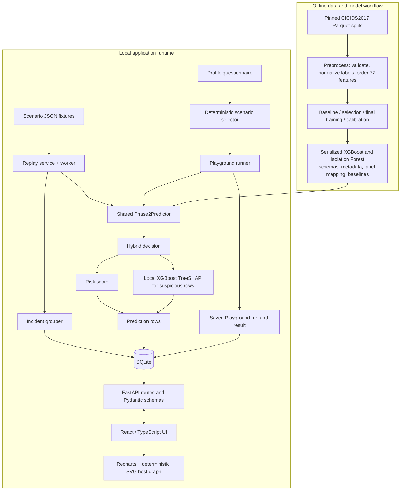

# System architecture

## Runtime components

The local runtime contains one FastAPI process, one React/Vite development server and one SQLite database. FastAPI lazily loads the saved predictor. Replay runs on an in-process worker thread; clients poll state. The Playground evaluates a small selected suite synchronously. No queue, separate inference service, WebSocket or deployment orchestrator is present.

## Offline ML components

`ml/preprocessing/` reads the pinned derivative, normalizes labels and produces a canonical ordered feature schema. Scripts under `ml/training/` run baseline/selection/final-model and Isolation Forest experiments. `ml/evaluation/` evaluates experiments and builds scenario fixtures. Inference artifacts and metadata are under `ml/artifacts/`; serialized model binaries are ignored and not included in a clean Git clone. Runtime thresholds and risk/Playground weights live in `config/config.yaml`.

## Backend components

- `backend/app/main.py` initializes SQLite and marks pending Playground runs interrupted at startup; it shuts down the replay worker on app shutdown.
- `backend/app/api/` provides prediction, replay, incidents/baseline and Playground routes.
- `backend/app/services/predictor.py` adapts model artifacts/config to one prediction contract.
- `backend/app/services/replay.py` reuses the predictor, persists each replay flow and updates incident groups.
- `backend/app/services/playground.py` selects suites, evaluates them via the predictor and persists separate result snapshots.
- `backend/app/db/` defines tables and database initialization.

## Frontend and trust boundaries

`frontend/src/api/` owns typed fetch helpers, response types and polling. `App.tsx` routes the Monitor, Incidents, Incident Detail and Playground. Recharts display actual saved values/counts. `CommGraph.tsx` uses source/destination host nodes and directed observed flow edges in stable SVG positions; connection ports are metadata. There is no Model Evaluation Lab page.

Only scenario evaluation consumes ground truth, after obtaining a model result, to calculate metrics. Ground-truth labels are not passed into `Phase2Predictor`. The prediction API persists individual engineering requests; replay persists run-tagged predictions and incidents; Playground data is stored separately and never creates Monitor incidents.

## Technology and scope

Python 3.10; pandas, NumPy, scikit-learn, XGBoost, PyArrow and joblib; FastAPI, Pydantic, SQLAlchemy, Uvicorn; SQLite; React 18, TypeScript, Vite, Tailwind, Recharts and SVG. Cytoscape.js is a frontend dependency in `package.json`, but the current graph component is SVG. Its presence in dependency metadata is not the active graph implementation.

Related detail: [API and persistence](backend-reference.md), [frontend and Playground](frontend-and-playground.md), [ML pipeline](ml-pipeline.md), [diagrams](diagrams.md).
