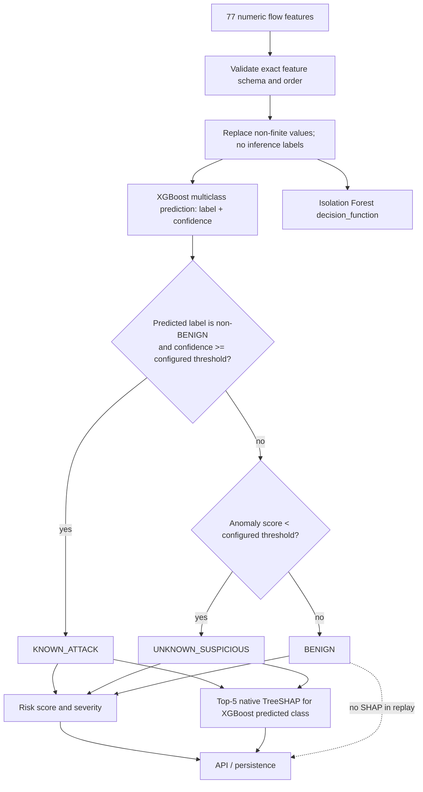
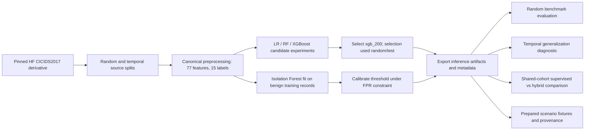
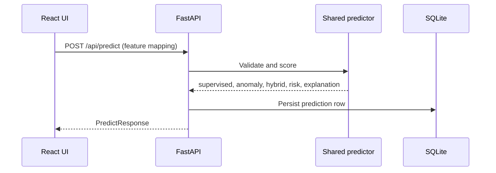
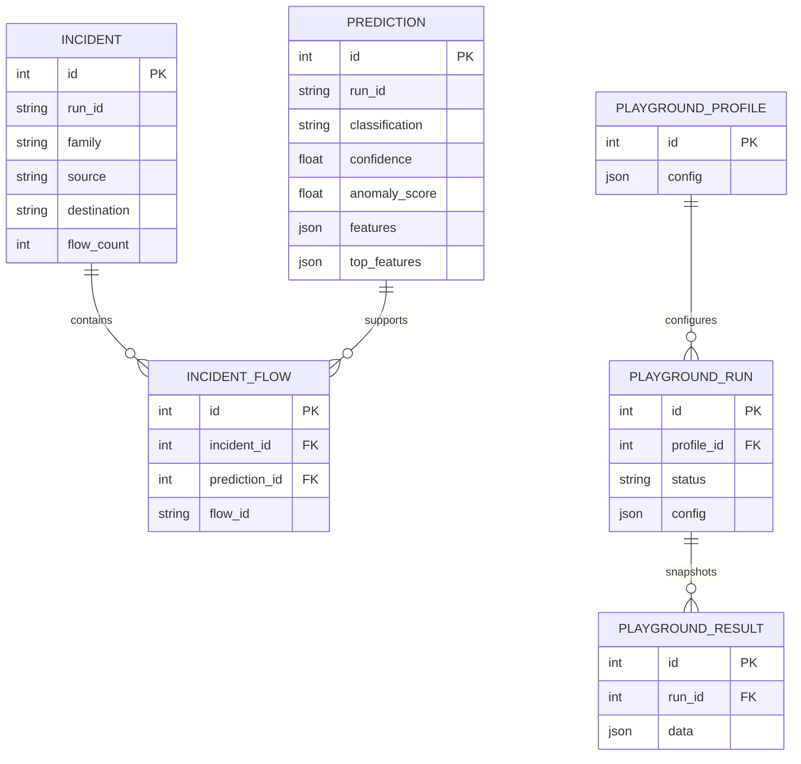
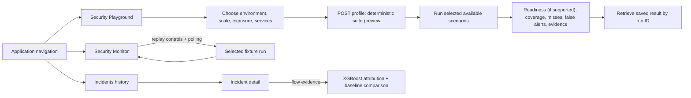

# Workflow diagrams

These editable Mermaid diagrams reflect current runtime behavior. They can be rendered by GitHub Markdown or a Mermaid-compatible editor.

## Flow scoring and hybrid decision



## Training and evaluation



## Prediction and API lifecycle



## Replay and incident lifecycle

```mermaid
sequenceDiagram
  participant UI as Monitor
  participant API as Replay API
  participant W as In-process worker
  participant P as Predictor
  participant G as Incident grouper
  participant DB as SQLite
  UI->>API: POST /api/replay/start
  API->>W: Validate suite and spawn run_id worker
  loop each fixture row in seq order
    W->>P: Predict features; explain only if suspicious
    P-->>W: Verdict and evidence
    W->>DB: Persist prediction
    W->>G: Assign suspicious flow
    G-->>W: Create/update/close group
    W->>DB: Persist incident and evidence links
  end
  UI->>API: Poll status, /flows?run_id=, /incidents?run_id=
  API-->>UI: Run-scoped persisted evidence
```

## Database entity relationship



SQLite tables are created by SQLAlchemy metadata initialization. JSON columns hold structured features, SHAP values, profile inputs and saved result payloads. Current schema/index detail is in [backend reference](backend-reference.md).

## Frontend routes and Playground workflow


