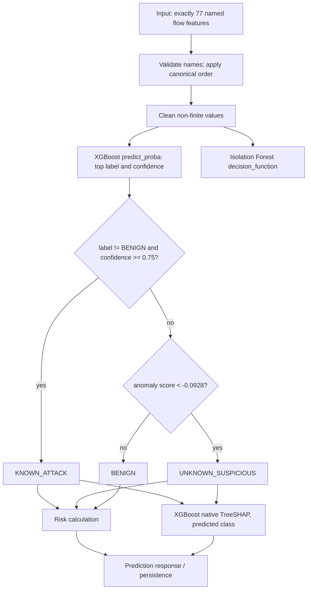

# Machine-learning pipeline

## Dataset and feature contract

The source is the Hugging Face dataset `lacg030175/CICIDS2017` at revision [`d071fd53782d9ca7cdc15173b8ceb858fea04628`](https://huggingface.co/datasets/lacg030175/CICIDS2017/tree/d071fd53782d9ca7cdc15173b8ceb858fea04628), a cleaned derivative of CICIDS2017 from the Canadian Institute for Cybersecurity. `config/config.yaml`, `ml/preprocessing/dataset.py`, `ml/artifacts/feature_schema.json` and `docs/DATA_ML_CONTRACT.md` define provenance and schema. The dataset convenience layer exposes distinct random and temporal configurations; it is not the raw official PCAP collection.

The raw feature frame has 80 flow-feature columns, including a duplicate `Fwd Header Length.1`, plus binary and multiclass labels. Preprocessing drops only that bit-for-bit duplicate feature and retains 77 canonical numeric features in the order in `ml/artifacts/feature_schema.json` and `ml/artifacts/inference/feature_order.json`. Non-finite numeric values are replaced by zero; class strings are normalized to 15 observed canonical labels. The mapping is implemented in `ml/preprocessing/labels.py` and committed in `ml/artifacts/label_mapping.json`. Tree models use unscaled numeric inputs. Logistic Regression baselines fit their scaler on training records only.

Inference accepts exactly the canonical feature keys. The prediction service validates missing/extra feature names and constructs the model vector in canonical order. Truth labels are held by evaluation fixture code and are used only after prediction to score outcomes.

## Models and artifacts

| Role | Current implementation |
|---|---|
| Baseline candidates | Logistic Regression, Random Forest and XGBoost, trained/evaluated separately for binary and multiclass tasks. |
| Runtime supervised model | XGBoost multiclass `xgb_200`: 200 trees, depth 6, learning rate 0.1, subsample 0.8, column sample 0.8, seed 42, histogram tree method, all CPU threads. Trained on the 300,000-row class-aware random training subset. |
| Runtime anomaly model | Isolation Forest, 200 estimators, `max_samples=auto`, `contamination=auto`, seed 42; fit on 88,314 benign rows from the development training subset, no scaling. |
| Runtime contract | 77 feature order, label/family mappings, benign statistics, model metadata, and config thresholds. |

Serialized models `ml/artifacts/supervised_model.joblib`, `ml/artifacts/isolation_forest.joblib` and inference model binaries are local ignored artifacts. JSON metadata are committed; a clean clone does not contain the binary estimators. Do not regenerate these casually: model binaries must correspond to their metadata, thresholds and saved evaluation evidence. See [running and model artifacts](running-the-project.md).

## Prediction pipeline

The order matters: a confident non-benign supervised class wins first. Otherwise, anomaly threshold crossing yields unknown suspicious regardless of whether the supervised prediction was benign or low-confidence malicious. Otherwise the result is benign. A benign prediction is not changed to a known attack by confidence alone.

### Semantics

- **`KNOWN_ATTACK`:** XGBoost predicts a non-benign canonical label and its top-class confidence is at least the configured threshold.
- **`UNKNOWN_SUSPICIOUS`:** the first rule did not apply and Isolation Forest score is below the anomaly threshold. This is an anomaly alert with no new-attack identity claim; it can be a false alert.
- **`BENIGN`:** neither rule flags the flow. It does not prove safety outside this model/dataset scope.
- **Confidence:** the top-class supervised model probability. It is not the hybrid's confidence.
- **Anomaly score:** raw Isolation Forest `decision_function`, not a probability; lower is more anomalous.
- **Risk:** bounded 0–100 project prioritization score. A benign output uses half the benign family base; suspicious outputs use family/unknown severity times `0.5 + 0.5*confidence` plus up to 15 anomaly points. Configured cutoffs label LOW/MEDIUM/HIGH/CRITICAL. This is not an industry standard.

Thresholds in current `config/config.yaml`: confidence 0.75, anomaly -0.0928. The anomaly threshold was selected on `random_3way/validation` by maximizing F1 under FPR ≤ 5%; standalone report uses disjoint `random_3way/test`. Evaluation thresholds in other experiments may differ; never substitute them for runtime config without a documented decision.

## Local explanations and normal baseline

`ml/hybrid/shap_explainer.py` requests XGBoost's native TreeSHAP contributions (`pred_contribs=True`) for the predicted class. Top five signed contributions are persisted for suspicious flows. Contributions sum with the bias to the predicted class raw margin. They explain the supervised model margin, not the anomaly score, final hybrid branch, causal mechanism or probability change. Replay and Playground avoid SHAP for benign flows to reduce work. Benign baseline summaries are descriptive statistics from 88,314 benign training flows for selected features; they contextualize feature values and are not another detector.

## Training and reproduction entry points

Relevant source: `ml/preprocessing/{dataset,preprocess,labels,subset}.py`, `ml/training/`, `ml/evaluation/`, `ml/hybrid/`. The exact candidate and calibration conditions are recorded in artifact metadata and JSON results. The model-selection experiment reused its random test split, so that result is development evidence, not an untouched final benchmark. The temporal protocol is a diagnostic rather than an equivalent random sample. See [evaluation](machine-learning/evaluation.md) before interpreting any metric and [commands](running-the-project.md) before running scripts that overwrite artifacts or JSON.
